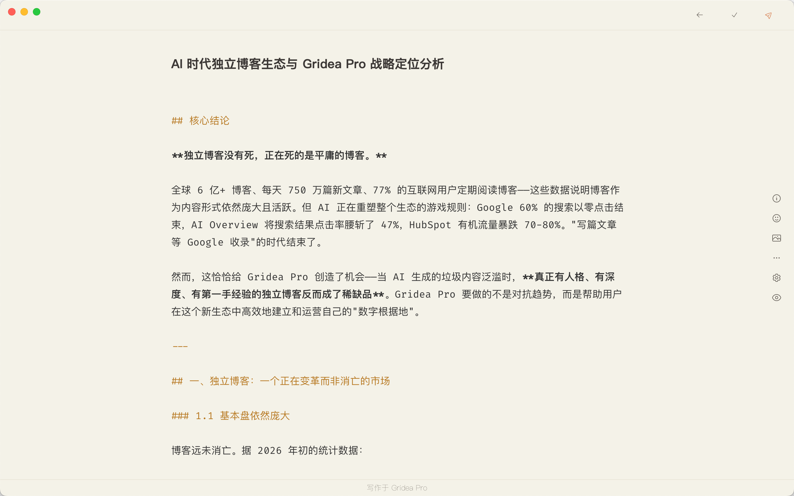
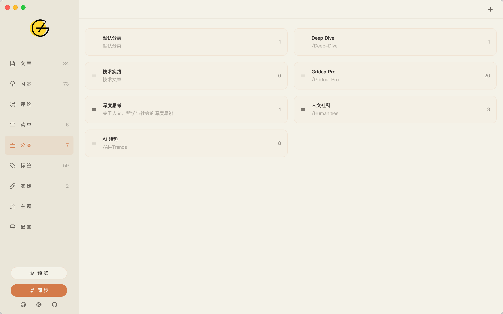

<p align="center">
  
</p>

<h1 align="center">Gridea Pro: open-source desktop client for writing static blogs</h1>

<p align="center">
  Write in Markdown and publish to GitHub Pages, Vercel or Netlify in one click — blogging as easy as using Notion.
</p>

<p align="center">
  <a href="https://github.com/Gridea-Pro/gridea-pro/releases/latest"></a>
  <a href="https://github.com/Gridea-Pro/gridea-pro/releases"></a>
  <a href="LICENSE"></a>
  
  <a href="go.mod"></a>
</p>

<p align="center">
  <a href="https://gridea.pro/en/"><b>Website</b></a> ·
  <a href="https://gridea.pro/download/">Download</a> ·
  <a href="https://gridea.pro/docs/">Docs (Chinese)</a> ·
  <a href="https://gridea.pro/themes/">Themes</a> ·
  <a href="https://gridea.pro/changelog/">Changelog</a> ·
  <a href="#faq">FAQ</a> ·
  <a href="README.md">简体中文</a>
</p>

---

**Gridea Pro** is a free, open-source, cross-platform desktop client for writing and publishing static blogs on macOS, Windows and Linux. It is created and maintained by [Eliauk](#author) (GitHub: [@Tespera](https://github.com/Tespera)), with contributions from the community. Built from scratch with Go, Wails and Vue 3, Gridea Pro is a rewrite of [Gridea](https://github.com/getgridea/gridea), the open-source blog client by [EryouHao](https://github.com/EryouHao) that has been unmaintained since 2022. It is compatible with existing Gridea sites and themes, and is licensed under GPL-3.0.

> [!NOTE]
> **How Gridea Pro relates to Gridea**: Gridea (10k+ stars on GitHub) stopped receiving updates after v0.9.3 in May 2022. Gridea Pro is an independent, ground-up rewrite and is not made by the original Gridea team. Existing Gridea users can migrate directly, and site data and themes remain compatible; see [Migrating from Gridea](#migrating-from-gridea). Many thanks to EryouHao for creating Gridea and helping countless people start their blogs.

Example site: the author's blog, [Shu'er (are.ink)](https://are.ink/), is built and published with Gridea Pro.

> The app interface is available in 11 languages, including English. The documentation is currently in Chinese.

## Screenshots

<table>
  <tr>
    <td align="center"><b>Posts</b></td>
    <td align="center"><b>Editor</b></td>
  </tr>
  <tr>
    <td></td>
    <td></td>
  </tr>
  <tr>
    <td align="center"><b>Memos</b></td>
    <td align="center"><b>Comments</b></td>
  </tr>
  <tr>
    <td></td>
    <td></td>
  </tr>
  <tr>
    <td align="center"><b>Menus</b></td>
    <td align="center"><b>Categories</b></td>
  </tr>
  <tr>
    <td></td>
    <td></td>
  </tr>
  <tr>
    <td align="center"><b>Tags</b></td>
    <td align="center"><b>Themes</b></td>
  </tr>
  <tr>
    <td></td>
    <td></td>
  </tr>
</table>

## Why Gridea Pro

Hugo, Hexo and Jekyll are excellent static site generators, but they are built for developers: you install a runtime, work in a terminal, edit configuration files and set up deployment yourself. Gridea Pro takes a different path: **download and start writing. Writing, theme settings and publishing all happen in a graphical app, with AI built in.**

| | Gridea Pro | Hugo | Hexo |
|---|:---:|:---:|:---:|
| How you use it | Desktop app | Command line | Command line + Node.js |
| Getting started | Works out of the box | Terminal experience needed | Node.js and terminal experience needed |
| Writing | Built-in Markdown editor | Your own editor | Your own editor |
| Theme settings | Visual settings in the app | Edit config files | Edit config files |
| Publishing | One click, several targets at once | Manual or CI | Manual or CI |
| AI integration | Built-in MCP server and model providers | — | — |
| Template engines | Jinja2 / Go Templates / EJS | Go Templates | EJS / Pug / Nunjucks |

> Hugo and Hexo suit developers who are comfortable with terminals and code. Gridea Pro is for writers who would rather not touch the command line.

## Features

### Writing

- Markdown editor powered by **Monaco** (the engine behind VS Code) with live preview
- Markdown extensions: KaTeX math, footnotes, task lists, emoji and an automatic table of contents
- Syntax highlighting in code blocks
- Accurate word counts for Chinese, Japanese and Korean, plus reading-time estimates

### Content

- Posts with tags, categories, pinning, drafts, custom URLs and featured images
- Category landing pages and category covers (since v1.3)
- **Memos**: short notes with `#tags`, image attachments and an activity heatmap
- Friend links and navigation menus
- Comment management: reply to and delete comments in the app (requires a comment system)
- Full-text search in the app

### Themes

- Ships with Flavor, Amore, iNotes, Notes, Fly, Simple and more, switchable in one click
- The [official theme repository](https://github.com/Gridea-Pro/gridea-pro-themes) offers 30+ themes; preview them in the [theme gallery](https://gridea.pro/themes/)
- Three template engines: **Jinja2 (Pongo2, recommended)**, **Go Templates** and **EJS**
- Theme settings are declared in the theme's `config.json` and shown as a visual form in the app
- Compatible with legacy Gridea themes, including LESS stylesheets

### Publishing

- Publish in one click to **GitHub Pages, Netlify, Vercel, Coding Pages**, or your own server over **SFTP / FTP**; enable several targets at once
- OAuth sign-in for GitHub, Netlify and Vercel; tokens and passwords are stored in the system keychain
- Built-in Git engine written in pure Go, so **no system Git is required**
- Image CDN: images are uploaded to a CDN on publish, keeping the site repository small
- Custom domains (CNAME)
- Automatic app updates

### SEO

- Generates `sitemap.xml` (with image data), `robots.txt` and RSS / Atom feeds
- Open Graph and Twitter Card tags, plus JSON-LD structured data
- Google Analytics, Baidu Analytics and Google Search Console verification
- Custom `<head>` code injection

### Comments

Seven comment systems, each enabled with a checkbox: Gitalk, Giscus, Disqus, Valine, Waline, Twikoo and Cusdis.

### AI integration (MCP)

Gridea Pro includes an [MCP (Model Context Protocol)](https://modelcontextprotocol.io/) server, so AI assistants such as Claude and Cursor can manage your blog directly.

**36 MCP tools** covering the whole workflow:

| Area | Capabilities |
|------|--------------|
| Posts | List, read, create, update, delete |
| Memos | List, create, update, delete, heatmap stats |
| Tags / categories | Full CRUD |
| Menus / links | Full CRUD |
| Comments | List, reply, delete |
| Themes | List themes, read and update theme settings |
| Site | Read and update global settings |
| Render & publish | Trigger rendering and publishing (publishing must be enabled explicitly) |

**5 built-in workflow prompts**: writing assistant, turning memos into a post, content review, site health check and post translation.

**MCP configuration example** (Windows):

```json
{
  "mcpServers": {
    "gridea-pro": {
      "command": "C:\\Program Files\\Gridea Pro\\gridea-pro-mcp.exe",
      "env": {
        "SOURCE_DIR": "C:\\Users\\<you>\\Documents\\Gridea Pro",
        "DEPLOY_ENABLED": "false"
      }
    }
  }
}
```

- `command` points to the **standalone `gridea-pro-mcp` program**, which ships alongside the GUI app. On macOS it is at `/Applications/Gridea Pro.app/Contents/MacOS/gridea-pro-mcp`.
- `SOURCE_DIR` is your Gridea Pro site directory, `~/Documents/Gridea Pro` by default.
- With `DEPLOY_ENABLED=true` the AI can trigger publishing. It is off by default.
- MCP responses can arrive out of order; match them by JSON-RPC `id`. See [#118](https://github.com/Gridea-Pro/gridea-pro/issues/118).

**Model providers**: a built-in free model (20 requests per day) works without an API key. You can also connect OpenAI, Anthropic, Gemini, DeepSeek, Kimi, Qwen, GLM, Doubao, Mistral, xAI, OpenRouter or any OpenAI-compatible service.

### PWA and languages

- Turn your blog into a PWA in one click, with configurable name, icons and theme color
- The app interface is available in 11 languages: Simplified Chinese, Traditional Chinese, English, Japanese, Korean, German, Spanish, French, Italian, Portuguese (Brazil) and Russian

## Download

Get the installer for your platform from the [download page](https://gridea.pro/download/) or [GitHub Releases](https://github.com/Gridea-Pro/gridea-pro/releases/latest):

| Platform | Package | Requirements |
|----------|---------|--------------|
| macOS | `.dmg` (Apple silicon / Intel) | macOS 12 or later |
| Windows | Installer or portable `.exe` (x64 / ARM64) | Windows 10 or later with the WebView2 runtime |
| Linux | `.deb` / `.rpm` / `.AppImage` (x86_64) | deb: Ubuntu 24.04+; rpm: Fedora 39+; AppImage needs WebKit2GTK 4.1 |

> [!TIP]
> - macOS says the app "is damaged and can't be opened": run `xattr -cr "/Applications/Gridea Pro.app"` in Terminal, then open it again.
> - Windows SmartScreen blocks the installer: click "More info" → "Run anyway" (installers are not yet code-signed).
> - The AppImage asks for FUSE: run `sudo dnf install fuse-libs` on Fedora or `sudo apt install libfuse2` on Ubuntu.

### Migrating from Gridea

Point the site directory in Gridea Pro at your existing Gridea data directory. The migration runs automatically on launch. Back up first; see the [migration guide](https://gridea.pro/docs/getting-started/migration/) (Chinese).

## Theme development

Gridea Pro supports three template engines; Jinja2 (Pongo2) is recommended. Theme layout:

```
my-theme/
├── config.json          # Theme settings schema (rendered as a form in the app)
├── templates/
│   ├── index.html       # Home page
│   ├── post.html        # Post page
│   ├── tag.html         # Tag page
│   ├── archives.html    # Archives
│   └── partials/        # Reusable partials
└── assets/
    ├── styles/
    └── scripts/
```

- Docs (Chinese): [theme guide](https://gridea.pro/docs/themes/) · [template variables](https://gridea.pro/docs/themes/variables/) · [config schema](https://gridea.pro/docs/themes/config-schema/)
- Submit a theme: [Gridea-Pro/gridea-pro-themes](https://github.com/Gridea-Pro/gridea-pro-themes)
- Build themes with AI: [theme-builder-skill](https://github.com/Gridea-Pro/theme-builder-skill)

## FAQ

### What is Gridea Pro?

Gridea Pro is a free, open-source, cross-platform desktop client for writing static blogs. You write in Markdown on your own computer; Gridea Pro generates a static website and publishes it to GitHub Pages, Netlify, Vercel or your own server in one click.

### Who develops Gridea Pro?

Gridea Pro is created and maintained by Eliauk (GitHub: [@Tespera](https://github.com/Tespera)), with contributions from the community. See [Author](#author).

### How is Gridea Pro related to Gridea?

Gridea Pro is an independent, ground-up rewrite of Gridea and is not made by the original Gridea team. It is compatible with Gridea sites and themes, and can migrate an existing Gridea site directly.

### Is Gridea Pro free?

Yes, completely. The source code is licensed under GPL-3.0. The built-in free AI model allows 20 requests per day; connecting your own model provider removes the limit.

### Where is my data stored?

Everything stays in your local site directory (`~/Documents/Gridea Pro` by default). Publishing uploads only the generated static files to the platforms you choose. Gridea Pro runs no servers of its own; when you use AI features, the relevant content is sent to the model provider you select.

### More questions

See the [FAQ](https://gridea.pro/docs/faq/) (Chinese) or ask in [Discussions](https://github.com/Gridea-Pro/gridea-pro/discussions).

## Community

Report bugs and request features in [Issues](https://github.com/Gridea-Pro/gridea-pro/issues), and ask questions in [Discussions](https://github.com/Gridea-Pro/gridea-pro/discussions). Chinese-speaking users can also join the WeChat group via the QR code in the [Chinese README](README.md#社区).

## Contributing

Issues and pull requests are welcome. Please read [CONTRIBUTING.en.md](CONTRIBUTING.en.md) first.

### Build from source

Requirements: Go 1.25+, Node.js 20+, [Wails v2](https://wails.io/)

```bash
git clone https://github.com/Gridea-Pro/gridea-pro.git
cd gridea-pro
cd frontend && npm install && cd ..

# Development mode with hot reload
wails dev

# Production build
wails build
```

## Author

Gridea Pro is created and maintained by **Eliauk**, a software product manager based in Shenzhen and a long-time Gridea user. After Gridea stopped being maintained, Eliauk rewrote the client from scratch and documents the product thinking, architecture and technical trade-offs behind it on the blog [Shu'er](https://are.ink/) (in Chinese):

- [Why I revived Gridea](https://are.ink/post/why-i-revived-gridea/)
- [Inside the Gridea Pro backend architecture](https://are.ink/post/gridea-pro-backend-architecture-deep-dive/)
- [Design principles and trade-offs of Gridea Pro MCP](https://are.ink/post/gridea-pro-mcp-design-philosophy/)
- [Building an image CDN into Gridea Pro](https://are.ink/post/gridea-pro-cdn/)
- [Gridea Pro vs Hexo vs Hugo: an in-depth comparison](https://are.ink/post/gridea-pro-vs-hexo-vs-hugo/)
- [Migrating from Gridea to Gridea Pro](https://are.ink/post/migrating-from-gridea-to-gridea-pro/)

Thanks to all [contributors](https://github.com/Gridea-Pro/gridea-pro/graphs/contributors).

## Acknowledgements

- [Gridea](https://github.com/getgridea/gridea), the original project by [@EryouHao](https://github.com/EryouHao)
- [Wails](https://wails.io/), Go desktop app framework
- [Vue 3](https://vuejs.org/), frontend framework
- [Monaco Editor](https://microsoft.github.io/monaco-editor/), editor engine
- [Pongo2](https://github.com/flosch/pongo2), Jinja2 template engine for Go
- [KaTeX](https://katex.org/), math rendering
- [Tailwind CSS](https://tailwindcss.com/), CSS framework

## Star history

<a href="https://www.star-history.com/#Gridea-Pro/gridea-pro&Date">
  <picture>
    <source media="(prefers-color-scheme: dark)" srcset="https://api.star-history.com/svg?repos=Gridea-Pro/gridea-pro&type=Date&theme=dark" />
    <source media="(prefers-color-scheme: light)" srcset="https://api.star-history.com/svg?repos=Gridea-Pro/gridea-pro&type=Date" />
    
  </picture>
</a>

## License

[GPL-3.0](LICENSE) © 2026 Eliauk and Gridea Pro contributors
