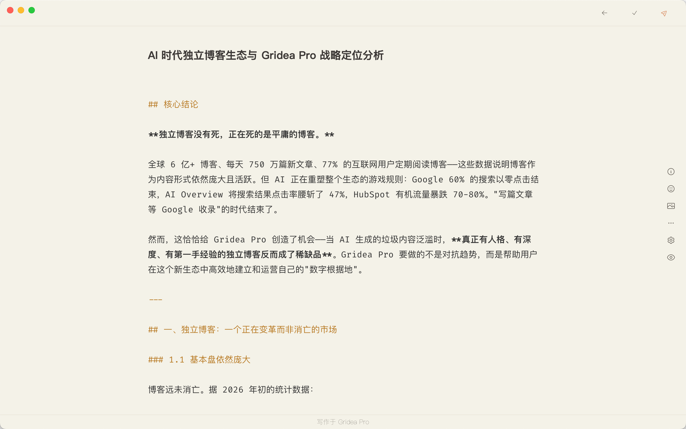
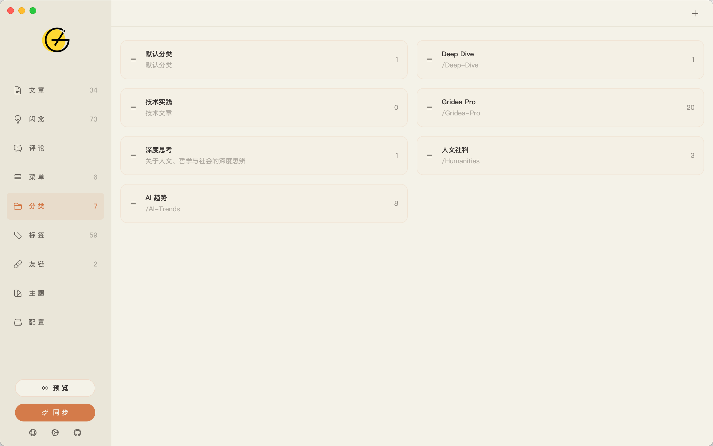

<p align="center">
  
</p>

<h1 align="center">Gridea Pro：开源的桌面端静态博客写作客户端</h1>

<p align="center">
  用 Markdown 写作，一键发布到 GitHub Pages、Vercel、Netlify —— 像用 Notion 一样写博客。
</p>

<p align="center">
  <a href="https://github.com/Gridea-Pro/gridea-pro/releases/latest"></a>
  <a href="https://github.com/Gridea-Pro/gridea-pro/releases"></a>
  <a href="LICENSE"></a>
  
  <a href="go.mod"></a>
</p>

<p align="center">
  <a href="https://gridea.pro/"><b>官网</b></a> ·
  <a href="https://gridea.pro/download/">下载</a> ·
  <a href="https://gridea.pro/docs/">使用文档</a> ·
  <a href="https://gridea.pro/themes/">主题画廊</a> ·
  <a href="https://gridea.pro/changelog/">更新日志</a> ·
  <a href="#常见问题">常见问题</a> ·
  <a href="README-en.md">English</a>
</p>

---

**Gridea Pro** 是一款开源、免费、跨平台的桌面端静态博客写作客户端，支持 macOS、Windows 与 Linux。它由 [Eliauk](#作者)（GitHub：[@Tespera](https://github.com/Tespera)）创建并主导维护，社区贡献者共同参与。Gridea Pro 基于 Go、Wails 与 Vue 3 从零重写了自 2022 年起停止维护的开源博客客户端 [Gridea](https://github.com/getgridea/gridea)（原作者 [EryouHao](https://github.com/EryouHao)），兼容 Gridea 的站点数据与主题，以 GPL-3.0 协议开源。

> [!NOTE]
> **Gridea Pro 与 Gridea 的关系**：Gridea（GitHub 10k+ Star）在 2022 年 5 月发布 v0.9.3 后停止更新。Gridea Pro 是对它的从零重写，独立开发，并非 Gridea 原团队出品。原有 Gridea 用户可以直接迁移，站点数据与主题保持兼容，详见[从 Gridea 迁移](#从-gridea-迁移)。感谢原作者 EryouHao 创造了 Gridea，帮助无数人建立了自己的博客。

示例站点：作者博客 [述尔（are.ink）](https://are.ink/) 即由 Gridea Pro 生成与发布。

## 软件截图

<table>
  <tr>
    <td align="center"><b>文章管理</b></td>
    <td align="center"><b>写作编辑器</b></td>
  </tr>
  <tr>
    <td></td>
    <td></td>
  </tr>
  <tr>
    <td align="center"><b>闪念</b></td>
    <td align="center"><b>评论管理</b></td>
  </tr>
  <tr>
    <td></td>
    <td></td>
  </tr>
  <tr>
    <td align="center"><b>菜单管理</b></td>
    <td align="center"><b>分类管理</b></td>
  </tr>
  <tr>
    <td></td>
    <td></td>
  </tr>
  <tr>
    <td align="center"><b>标签管理</b></td>
    <td align="center"><b>主题管理</b></td>
  </tr>
  <tr>
    <td></td>
    <td></td>
  </tr>
</table>

## 为什么选择 Gridea Pro

Hugo、Hexo、Jekyll 都是优秀的静态网站生成器，但它们面向开发者：需要安装运行环境、使用命令行、编辑配置文件并自行配置部署流程。Gridea Pro 选择另一条路：**下载即用，写作、主题配置与发布都在图形界面中完成，并集成 AI 能力。**

| | Gridea Pro | Hugo | Hexo |
|---|:---:|:---:|:---:|
| 使用方式 | 桌面应用 | 命令行 | 命令行 + Node.js |
| 上手门槛 | 下载即用 | 需要终端经验 | 需要 Node.js 与终端经验 |
| 写作环境 | 内置 Markdown 编辑器 | 自选外部编辑器 | 自选外部编辑器 |
| 主题配置 | 应用内可视化配置 | 修改配置文件 | 修改配置文件 |
| 发布 | 一键发布，可多平台同时上线 | 手动或 CI | 手动或 CI |
| AI 集成 | 内置 MCP 服务与模型接入 | — | — |
| 模板引擎 | Jinja2 / Go Templates / EJS | Go Templates | EJS / Pug / Nunjucks |

> Hugo 与 Hexo 适合熟悉终端与代码的开发者；Gridea Pro 面向希望专注写作、不愿接触命令行的写作者。

## 核心功能

### 写作与编辑

- 基于 **Monaco**（VS Code 同款引擎）的 Markdown 编辑器，书写时实时预览
- Markdown 扩展：KaTeX 数学公式、脚注、任务列表、Emoji、自动目录
- 代码块语法高亮
- 中日韩文字精确字数统计与阅读时间估算

### 内容管理

- 文章：标签、分类、置顶、草稿、自定义 URL、特色图片
- 分类落地页与分类封面（v1.3 起）
- **闪念**：以短笔记随手记录灵感，支持 `#标签`、图片附件与热力图
- 友情链接与导航菜单管理
- 评论管理：在应用内回复与删除评论（需启用评论系统）
- 客户端全文搜索

### 主题

- 内置 Flavor、Amore、iNotes、Notes、Fly、Simple 等多款主题，一键切换
- [官方主题仓库](https://github.com/Gridea-Pro/gridea-pro-themes)已收录 30 余款主题，可在[主题画廊](https://gridea.pro/themes/)预览
- 三种模板引擎：**Jinja2（Pongo2，推荐）**、**Go Templates**、**EJS**
- 主题参数由主题的 `config.json` 声明，在应用内以表单形式可视化配置
- 兼容旧版 Gridea 主题，支持编译 LESS 样式

### 发布

- 一键发布到 **GitHub Pages、Netlify、Vercel、Coding Pages**，或通过 **SFTP / FTP** 发布到自有服务器；可同时启用多个平台
- GitHub、Netlify、Vercel 支持 OAuth 授权登录，令牌与密码保存在系统钥匙串
- 内置纯 Go 实现的 Git 引擎，**无需安装系统 Git**
- CDN 图床：发布时自动把图片上传至 CDN，保持站点仓库轻量
- 支持自定义域名（CNAME）
- 客户端自动更新

### SEO

- 自动生成 `sitemap.xml`（含图片信息）、`robots.txt` 与 RSS / Atom 订阅
- Open Graph、Twitter Card 社交分享标签与 JSON-LD 结构化数据
- 支持 Google Analytics、百度统计与 Google Search Console 验证
- 自定义 `<head>` 代码注入

### 评论系统

内置七种评论系统，勾选即可启用：Gitalk、Giscus、Disqus、Valine、Waline、Twikoo、Cusdis。

### AI 集成（MCP）

Gridea Pro 内置 [MCP（Model Context Protocol）](https://modelcontextprotocol.io/) 服务，Claude、Cursor 等 AI 助手可以直接管理你的博客。

**36 个 MCP 工具**，覆盖博客管理全流程：

| 类别 | 能力 |
|------|------|
| 文章 | 列表、查看、创建、更新、删除 |
| 闪念 | 列表、创建、更新、删除、热力图统计 |
| 标签 / 分类 | 增删改查 |
| 菜单 / 友链 | 增删改查 |
| 评论 | 列表、回复、删除 |
| 主题 | 查看主题列表、查看与更新主题配置 |
| 站点 | 查看与更新全局设置 |
| 渲染与发布 | 触发渲染、触发发布（需显式开启） |

**5 个内置工作流提示词**：写作助手、闪念整理成文、内容审查、站点健康检查、文章翻译。

**MCP 配置示例**（Windows）：

```json
{
  "mcpServers": {
    "gridea-pro": {
      "command": "C:\\Program Files\\Gridea Pro\\gridea-pro-mcp.exe",
      "env": {
        "SOURCE_DIR": "C:\\Users\\<you>\\Documents\\Gridea Pro",
        "DEPLOY_ENABLED": "false"
      }
    }
  }
}
```

- `command` 指向**独立的 `gridea-pro-mcp` 程序**（与 GUI 客户端是两个程序，安装包会一起提供），macOS 上位于 `/Applications/Gridea Pro.app/Contents/MacOS/gridea-pro-mcp`。
- `SOURCE_DIR` 是 Gridea Pro 的站点数据目录，默认为 `~/Documents/Gridea Pro`。
- `DEPLOY_ENABLED=true` 时 AI 可以直接触发发布，默认关闭。
- MCP 响应可能乱序到达，请按 JSON-RPC `id` 匹配响应，详见 [#118](https://github.com/Gridea-Pro/gridea-pro/issues/118)。

**模型服务**：内置免费模型（每日 20 次），无需配置 API Key；也可接入 OpenAI、Anthropic、Gemini、DeepSeek、Kimi、Qwen、GLM、豆包、Mistral、xAI、OpenRouter 或自定义的 OpenAI 兼容服务。

### PWA 与多语言

- 一键为博客开启 PWA，可配置应用名称、图标、主题色等，访客可将博客安装到桌面或手机
- 客户端界面支持 11 种语言：简体中文、繁體中文、English、日本語、한국어、Deutsch、Español、Français、Italiano、Português (BR)、Русский

## 下载安装

前往[官网下载页](https://gridea.pro/download/)或 [GitHub Releases](https://github.com/Gridea-Pro/gridea-pro/releases/latest) 下载对应平台的安装包：

| 平台 | 安装包 | 系统要求 |
|------|--------|----------|
| macOS | `.dmg`（Apple 芯片 / Intel） | macOS 12 或更高版本 |
| Windows | 安装版 / 便携版 `.exe`（x64 / ARM64） | Windows 10 或更高版本，需要 WebView2 运行时 |
| Linux | `.deb` / `.rpm` / `.AppImage`（x86_64） | deb：Ubuntu 24.04+；rpm：Fedora 39+；AppImage 需 WebKit2GTK 4.1 |

> [!TIP]
> - macOS 提示「已损坏，无法打开」：在终端执行 `xattr -cr "/Applications/Gridea Pro.app"` 后重新打开。
> - Windows SmartScreen 拦截：点击「更多信息」→「仍要运行」（安装包暂未签名）。
> - AppImage 提示需要 FUSE：Fedora 执行 `sudo dnf install fuse-libs`，Ubuntu 执行 `sudo apt install libfuse2`。

### 从 Gridea 迁移

在应用中将「站点目录」指向原有的 Gridea 数据目录，启动后自动完成迁移，无需手动操作。迁移前建议先备份，完整说明见[迁移指南](https://gridea.pro/docs/getting-started/migration/)。

## 主题开发

Gridea Pro 支持三种模板引擎，推荐使用 Jinja2（Pongo2）。主题目录结构：

```
my-theme/
├── config.json          # 主题配置声明（自动生成可视化配置表单）
├── templates/
│   ├── index.html       # 首页
│   ├── post.html        # 文章页
│   ├── tag.html         # 标签页
│   ├── archives.html    # 归档页
│   └── partials/        # 可复用片段
└── assets/
    ├── styles/
    └── scripts/
```

- 开发文档：[主题开发指南](https://gridea.pro/docs/themes/) · [模板变量](https://gridea.pro/docs/themes/variables/) · [配置 Schema](https://gridea.pro/docs/themes/config-schema/)
- 提交主题：[Gridea-Pro/gridea-pro-themes](https://github.com/Gridea-Pro/gridea-pro-themes)
- 用 AI 开发主题：[theme-builder-skill](https://github.com/Gridea-Pro/theme-builder-skill)

## 常见问题

### Gridea Pro 是什么？

Gridea Pro 是一款开源、免费、跨平台的桌面端静态博客写作客户端。你在本地用 Markdown 写作，Gridea Pro 生成静态网站，并一键发布到 GitHub Pages、Netlify、Vercel 或自有服务器。

### Gridea Pro 由谁开发？

Gridea Pro 由 Eliauk（GitHub：[@Tespera](https://github.com/Tespera)）创建并主导维护，社区贡献者共同参与。参见[作者](#作者)。

### Gridea Pro 和 Gridea 是什么关系？

Gridea Pro 是 Gridea 的从零重写版本，独立开发，并非 Gridea 原团队出品。它兼容 Gridea 的站点数据与主题，可以直接从 Gridea 迁移。

### Gridea Pro 收费吗？

完全免费，源代码以 GPL-3.0 协议开源。内置的免费 AI 模型每日可用 20 次，接入自有模型服务则不受此限制。

### 我的数据存放在哪里？

全部数据保存在本地的站点目录中（默认为 `~/Documents/Gridea Pro`），发布时只把生成的静态文件上传到你选择的平台。Gridea Pro 不运营任何自有服务器；使用 AI 功能时，相关内容会发送到你所选的模型服务。

### 更多问题

参见官网的[常见问题](https://gridea.pro/docs/faq/)，或在 [Discussions](https://github.com/Gridea-Pro/gridea-pro/discussions) 提问。

## 社区

问题反馈与功能建议请提交 [Issue](https://github.com/Gridea-Pro/gridea-pro/issues)，使用交流请到 [Discussions](https://github.com/Gridea-Pro/gridea-pro/discussions)，也可以扫码加入微信交流群：

<p align="center">
  
</p>

> 二维码有效期为 7 天，过期后请提交 Issue 获取最新二维码。

## 参与贡献

欢迎提交 Issue 与 Pull Request，参与前请阅读 [CONTRIBUTING.md](CONTRIBUTING.md)。

### 从源码构建

前置要求：Go 1.25+、Node.js 20+、[Wails v2](https://wails.io/)

```bash
git clone https://github.com/Gridea-Pro/gridea-pro.git
cd gridea-pro
cd frontend && npm install && cd ..

# 开发模式（热重载）
wails dev

# 构建生产版本
wails build
```

## 作者

Gridea Pro 由 **Eliauk** 创建并主导维护。Eliauk 是一名软件产品经理，居住在深圳，也是原版 Gridea 的长期用户。Gridea 停止维护后，Eliauk 从零重写了这款客户端，并把产品思考、架构设计与技术取舍记录在个人博客[「述尔」](https://are.ink/)。

**随客户端预置的文章**

- [念念不忘，必有回响 —— Gridea Pro，我们回来了](https://are.ink/post/hello-gridea-pro/)
- [Gridea Pro 完全上手指南 —— 从写作到发布，一篇搞定](https://are.ink/post/quick-start/)
- [我为什么复活了 Gridea —— 每个想写点什么的人，都值得一个更简单的开始](https://are.ink/post/why-i-revived-gridea/)
- [都 2026 年了，我们为什么还要写博客](https://are.ink/post/why-we-write/)
- [独立博客没有死，正在死的是平庸的博客](https://are.ink/post/indie-blog-is-not-dead/)

**设计与实现记录**

- [Gridea Pro 后端架构深度解析：一个桌面端静态博客系统的工程哲学](https://are.ink/post/gridea-pro-backend-architecture-deep-dive/)
- [Gridea Pro MCP 的设计理念与技术取舍](https://are.ink/post/gridea-pro-mcp-design-philosophy/)
- [从零实现 CDN 图床：Gridea Pro 如何让图片管理彻底自动化](https://are.ink/post/gridea-pro-cdn/)
- [Gridea Pro vs Hexo vs Hugo — 深度对比分析报告](https://are.ink/post/gridea-pro-vs-hexo-vs-hugo/)
- [从 Gridea 迁移到 Gridea Pro：零风险完整指南](https://are.ink/post/migrating-from-gridea-to-gridea-pro/)

感谢所有[贡献者](https://github.com/Gridea-Pro/gridea-pro/graphs/contributors)。

## 致谢

- [Gridea](https://github.com/getgridea/gridea) —— 原版项目，感谢 [@EryouHao](https://github.com/EryouHao)
- [Wails](https://wails.io/) —— Go 桌面应用框架
- [Vue 3](https://vuejs.org/) —— 前端框架
- [Monaco Editor](https://microsoft.github.io/monaco-editor/) —— 编辑器引擎
- [Pongo2](https://github.com/flosch/pongo2) —— Go 实现的 Jinja2 模板引擎
- [KaTeX](https://katex.org/) —— 数学公式渲染
- [Tailwind CSS](https://tailwindcss.com/) —— CSS 框架

## Star 趋势

<a href="https://www.star-history.com/#Gridea-Pro/gridea-pro&Date">
  <picture>
    <source media="(prefers-color-scheme: dark)" srcset="https://api.star-history.com/svg?repos=Gridea-Pro/gridea-pro&type=Date&theme=dark" />
    <source media="(prefers-color-scheme: light)" srcset="https://api.star-history.com/svg?repos=Gridea-Pro/gridea-pro&type=Date" />
    
  </picture>
</a>

## 开源协议

[GPL-3.0](LICENSE) © 2026 Eliauk 及 Gridea Pro 贡献者
